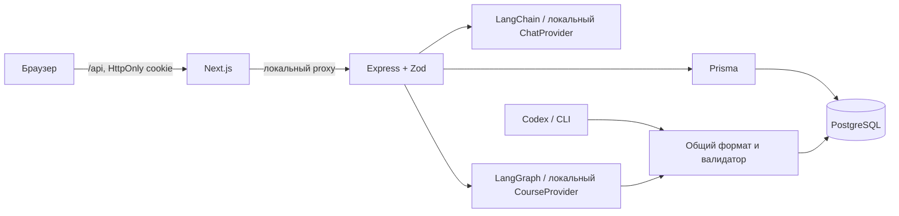

# Архитектура LangPlot

## Данные

`User` хранит профиль, настройки и выбранные язык/уровень. `Session` — SHA-256 случайного 256-битного токена, дату истечения и связь с пользователем. В браузере — только HttpOnly SameSite=Lax cookie. Она Secure при HTTPS. Профиль не хранится в localStorage.

`ContentVersion` хранит неизменяемую версию декларативного пакета JSONB. Пара `(packageId, version)` уникальна. `Playthrough` ссылается на её ID и содержит `state` JSONB и целочисленную `revision`. Учебные попытки и `SkillState` привязаны к пользователю и языку, а не к прохождению. Статистические счётчики пока являются технической основой, не оценкой CEFR.

`PlayEvent` фиксирует ID запроса, вход и прежний результат. Обновление состояния и запись события происходят в одной транзакции. Условное обновление `WHERE revision = ожидаемая` предотвращает потерю параллельного изменения. Повтор ID и того же действия возвращает записанный результат; изменённый payload с тем же ID даёт 409. JSONB не гарантирует порядок ключей, поэтому сравниваются нормализованные Zod-поля.

В первом интерфейсе по одной технической проверке на пользователя/язык. Настоящие повторные прохождения и выбор глав добавляются отдельным сценарием позже. Загрузка/действия/переписка проверяют принадлежность прохождения пользователю.

## Переписка

`ChatExchange` хранит пользовательский текст, ответ, статус и номер попытки. Сервер создаёт pending-запись до обращения к провайдеру. Повтор completed не вызывает модель заново. Ошибка или отмена допускает повтор с тем же ID и увеличением номера попытки. Запоздавший ответ предыдущей попытки не может перезаписать новую.

Контекст включает текущую сцену, разрешённые факты собеседника и не более 10 последних завершённых обменов с ограничением длины. Ответ имеет Zod-структуру `reply`, `intent`, `observations`, `suggestedFlags`. Произвольные изменения флагов отвергаются; учебные наблюдения допускаются только для объявленных целей пакета. Тестовый провайдер не оценивает знания и возвращает пустые наблюдения.

Есть таймаут 8 секунд, отмена через endpoint и отмена при закрытии соединения. Завершение обмена, учебная попытка и обновление счётчиков выполняются в одной транзакции. После перезапуска pending-сообщения становятся failed с кодом INTERRUPTED. История отображает последние 100 обменов; контекст модели остаётся ограниченным отдельно.

## Студия

Задания `StudioJob` сохраняются в PostgreSQL до выполнения. Один локальный worker последовательно забирает очередь. LangGraph проходит задание, структуру, проверку, отчёт и экспорт; текущий этап записывается в базу. Незавершённые задания после перезапуска получают interrupted с возможностью явного повтора.

Граф и локальный Codex используют единый формат. Импорт — только JSON до 1 МБ; никаких исполняемых файлов или распаковки архивов. Ссылки на медиаресурсы проверяются, загрузка бинарных файлов ещё не открыта. Пустой каркас валиден как draft, но не publishable. Даже полностью проверенный пакет пока не публикуется в каталог автоматически.

## Границы

Express слушает loopback, запросы браузера идут через Next. Сервер проверяет Origin для изменений, JSON Content-Type, размер тела и лимит запросов. Приватные ответы имеют Cache-Control: no-store. Сессии принадлежат отдельным зарегистрированным аккаунтам. Вход использует scrypt и HttpOnly-cookie. Каждое обращение к CRM и студии проверяет роль в базе. Только главный администратор может назначать администраторов. Первичный доступ создаётся через одноразовое приглашение локального оператора.

Текущий сервер — один процесс, поэтому in-memory AbortController и очередь достаточны для демоверсии. Для нескольких экземпляров потребуется общая очередь, lease задач, распределённая отмена и отдельные worker-процессы. Внешние провайдеры сейчас не подключены; ответы, озвучка, облачное хранилище и аналитика не отправляют клиентские данные за пределы локальной машины.

Общие схемы API: `packages/shared/src/contracts.ts`. Основные группы: `/session`, `/profile`, `/catalog`, `/plays`, `/progress`, `/studio`. Ошибки: `{ error: { code, message, details? } }`. 401 — нет сессии; 409 — конфликт версии/ID; 400 — неверные данные; 413 — большой пакет; 503 — провайдер не настроен.
